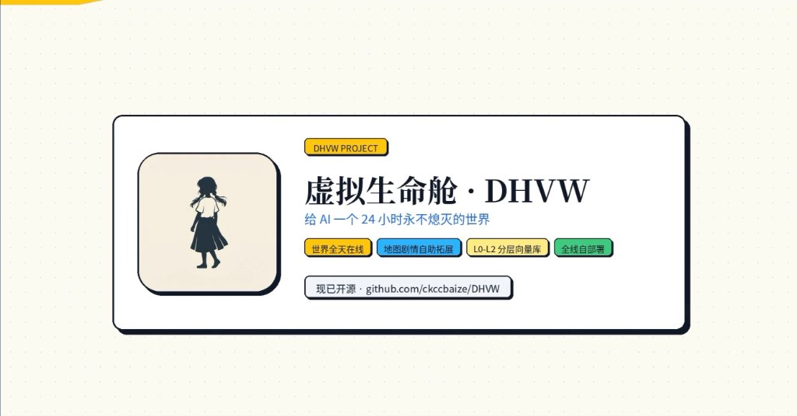

<p align="center">
  
</p>

<h1 align="center">DHVW 虚拟生命舱</h1>

<p align="center">
  <strong>给 AI 一个 24 小时永不熄灭的世界</strong><br />
  <em>Digital Human Virtual Warehouse · 局域网协同的桌面陪伴式数字人系统</em>
</p>

<p align="center">
  <a href="#-系统整体架构"></a>
  <a href="#1-pc-主机端开发与运行"></a>
  <a href="#2-arm-设备端开发与部署"></a>
  <a href="#-许可证与致谢"></a>
</p>

<p align="center">
  
</p>

---

## 🌟 项目功能简介

**DHVW 虚拟生命舱** 是一套面向未来的**软硬件协同桌面陪伴式数字人系统**。它将物理世界中的小屏幕硬件（ARM 终端）与高性能计算主机（PC）深度联结，让数字人不再只是冷冰冰的对话框工具，而是一个在桌面上拥有真实作息、喜怒哀乐与持久记忆的“虚拟生命体”：

* 🏠 **24 小时桌面独立生活**：放在桌面的专用微型设备（如 RK3566 硬件）上，数字人在多房间像素家园中穿梭漫游。她有自己的日常作息——清晨起床、餐桌用餐、书房阅读、窗边发呆、夜晚入眠，拥有完整的独立时间线。
* 🎙️ **一触即达的沉浸显现交互**：轻触屏幕或呼唤她，瞬间切换为全屏高精度 Live2D 拟真形象。支持毫秒级语音对讲、自然打断、口型同步匹配以及基于 GPT-SoVITS 的高质量声线克隆。
* 🧠 **像人一样思考的长期记忆**：具备拟人化的混合记忆系统。她会记住与你的过往点滴（饮食偏好、约定、重要日子），并遵循艾宾浩斯遗忘曲线真实衰减与复现。7 天前甚至数月前的话题，她依然能在对话中自然唤起。
* 🎭 **多维情绪与主动表达**：内心运行着细致的情绪模型（快乐、低落、疲劳、好奇度）。当发生特定事件、心情变化或久未受到关注时，她会自主冒出思考气泡，甚至主动开口搭话。
* 🎨 **零门槛人设工坊（Persona Studio）**：通过 PC 管理端，可自由调节人设性格、说话口吻、知识边界与音色模型；支持一键导入导出人设卡，让每位玩家都能雕琢独属于自己的虚拟伴侣。
* 📱 **跨端移动伴生（QQ 机器人）**：当离开书桌外出时，内置的伴生机器人插件（QQ-OpenClaw）能让你通过手机继续与她保持联络，消息与情绪实时互通。

---

## 💡 核心设计理念

### 1. 「是生命体，不是被动的工具」
传统 AI 助理只是无状态等待用户发问的“搜索引擎问答器”。DHVW 认为虚拟伴侣的本质在于**生命感与自主性**：
* 即使你一天不打开电脑，她的世界也在继续运转；
* 她有自己的小情绪，会无聊、会犯困、会有突发奇想；
* 交互建立在“平等陪伴”而非“单向指令”之上。

### 2. 「端脑协同（Edge-Brain Symbiosis）」
大模型的高功耗、高显存需求与桌面硬件 24 小时低功耗常开是一对经典矛盾。DHVW 采用创新的分工解法：
* **PC 端 = 核心大脑 & 生产车间（Heavy Engine）**：承载云端/本地大模型调度、向量索引抽取、TTS 高保真合成以及高阶场景/剧情生成。按需唤醒，随时关机。
* **ARM 端 = 物理生命舱 & 自治载体（Living Pod）**：低至几瓦功耗的 ARM 硬件（如 RK3566 2GB RAM）常开不关。通过轻量化 Go 静态离线壳与浏览器 Web Workers 状态机自治运行，**零外部网络与 PC 依赖下保障生命基础运转**。

### 3. 三大运行态与系统不变量
为了保证软硬件协同的绝对稳定性，系统严格遵循三条物理约束：
1. **总观常显（默认态）**：
   - 设备开机即进上帝视角像素生活，界面/地图/角色动作由本地资源包提供。**PC 关机绝不黑屏，生活照常推进**。
2. **显现交互（互斥态）**：
   - 依赖 PC 端算力。若 PC 不在局域网内或不可达，**设备绝不强行进入白屏或残缺态**，仅弹出提示气泡并保持总观。
3. **世界双档（主机优先）**：
   - **主机档（Host Tier）**：PC 在线且空闲时，由大模型出种子并生成丰富的生活剧情与新场景扩展。
   - **端侧档（Edge Tier）**：PC 离线时，ARM 状态机与文法生成器（`AssetForge`）接管，以 **0 Token、0 GPU** 消耗在本地自主演化。

---

## 🧭 核心功能全景

| 模块 | 核心能力 | 关键实现与落地点 |
|---|---|---|
| **桌面像素家园** | 24 小时作息、多房间自主漫游、家具交互、环境光照与天气响应 | Canvas 2D 分层无损渲染、BFS 寻路代理（`PathAgent`）、零 WebGL 极低占用 |
| **实时数字人对话** | 全屏 Live2D 交互、毫秒级 VAD 语音断句、流式语音合成、情绪动作驱动 | 基于 Open-LLM-VTuber 定制优化、GPT-SoVITS 声音推理、Cel 赛璐璐轻量 UI |
| **混合长期记忆** | 跨周期事实回忆、核心偏好置顶、对话自动摘要、时间遗忘曲线与记忆取代 | `sqlite-vec` (bge-small-zh-v1.5) 向量检索 + FTS5 全文检索 + 艾宾浩斯衰减 |
| **双轨大模型驱动** | 支持云端 API（DeepSeek/OpenAI 等）与 PC 本地离线 GGUF 大模型灵活切换 | 原生集成 `local_ai` (llama-server)、局域网透明转发代理、按需负载调度 |
| **可视化人设工坊** | 人设提示词可视化调优、性格维度滑块、音色/模型一键切换、人设卡导入导出 | PC Electron 45 外壳、React + Tailwind 控制面板、JSON 人设卡片标准 |
| **自主生活演进** | 动态生成日记剧情、随身物品更新、场景扩展与背景生成 | 双档生成器（主机档大模型种子 vs 端侧档 `AssetForge` 确定性文法） |
| **移动伴生通道** | 手机端与数字人同步聊天、心情与生活事件主动下发、代词百科联网查 | 可选插件 `qq-openclaw`、PC 凭据下发、抗机械化应答策略 |
| **安全局域网互联** | PC 与 ARM 自动发现、一键配对、自签 CA 证书与 HTTPS/WSS 代理 | 局域网网关（LAN Gateway）、动态端口冲突顺延、零公网安全设计 |

---

## 🏗️ 系统整体架构

仓库采用清晰的协同架构，划分为主机端与设备端两大核心目录：

```
DHVW/
├── PC/                  # PC 主机端一体化软件（大脑与能力源）
│   ├── apps/shell/      # Electron 45 外壳 (TypeScript + React + Vite + Tailwind)
│   ├── services/
│   │   ├── host/        # Python 宿主服务 (dhvw_host，生命周期托管与 Job Object 整树清理)
│   │   └── orchestrator/# 核心编排服务 (dhvw_orchestrator，混合记忆/模式机/生活流/网关)
│   ├── local_ai/        # 本地大模型引擎 (基于 llama.cpp / llama-server GGUF)
│   └── docs/            # PC 侧设计手册与开发规范
│
├── arm/                 # ARM 硬件终端软件（生命体与表现层）
│   ├── shell/           # Go 编写的轻量静态服务器 (127.0.0.1:8080，极低内存常驻)
│   ├── www/             # 前端运行时 (Canvas 2D 像素地图、Live2D 宿主、Web Workers)
│   │   ├── js/          # 核心生活状态机、网络路由与运行时调度
│   │   ├── workers/     # life.worker.js (自主作息调度) & forge.worker.js (端侧生成)
│   │   └── assets/      # 家园地图（5大功能区）与角色精灵素材
│   ├── qq-openclaw/     # 可选的 QQ 伴生机器人插件通道
│   ├── deploy/          # Armbian / RK3566 部署脚本与 systemd 服务配置
│   └── docs/            # 设备端规格与协议契约
│
└── docs/                # 项目全景规划、地图场景规格与素材许可台账
```

---

## 🚀 快速开始

### 1. PC 主机端开发与运行

**前置要求**：Windows 10/11 x64、Node.js 22+、Python 3.12、NVIDIA 显卡（用于语音与本地大模型）。

```bash
# 进入 PC 外壳工程目录
cd PC/apps/shell

# 1. 初始化并安装依赖（自动配置国内镜像源）
npm run setup

# 2. 编译并启动 PC 控制中心（同时调起 Python 编排引擎与网关）
npm run build
npm start

# 3. 构建独立 Windows 安装包（NSIS）
npm run dist
```

### 2. ARM 设备端开发与部署

**前置要求**：Linux (ARM64, 推荐 Armbian) 或开发机本地浏览器测试；Go 1.21+（编译设备壳）。

```bash
# 本地浏览器模拟测试（调试模式）
cd arm
npm install
npm run serve
# 浏览器访问: http://127.0.0.1:8080

# 交叉编译 ARM 静态服务壳
cd shell
sh build.sh   # 产物输出至 dist/dhvw-shell-linux-arm64

# 在 RK3566 硬件设备上部署运行
sudo sh deploy/install.sh dist/dhvw-shell-linux-arm64
```

---

## 💻 硬件基线

| 硬件规格 | PC 主机端 | ARM 终端生命舱 |
|---|---|---|
| **推荐平台** | Windows 10/11 (x64) | RK3566 (Quad Cortex-A55, Armbian) |
| **内存限制** | 16 GB+ 推荐 | **2 GB RAM 定型硬约束** |
| **持久存储** | SSD 高速磁盘 | 32 GB eMMC |
| **显示方案** | 主屏管理控制台与人设工坊 | 1080p 竖屏 / 倒装显示 (Chromium Kiosk) |
| **网络要求** | 局域网接入 (Wi-Fi / 有线) | 局域网互通即可，不依赖公网端口映射 |

---

## 📜 许可证与致谢

- 本项目定位为非商用开源项目。
- 像素场景与地图体系借鉴并致谢 [ai-town](https://github.com/a16z-infra/ai-town) 及 [pixel-agents](https://github.com/antirez/pixel-agents)。
- 语音与对话能力基于 [Open-LLM-VTuber](https://github.com/Open-LLM-VTuber/Open-LLM-VTuber) 框架拓展定制。
- 素材来源与许可明细详见 [docs/ASSETS-LICENSE.md](docs/ASSETS-LICENSE.md)。
---
## 反馈联系 q群 1091280824
